<div align="center">

# Almofadada

**Party game 3D para jogar no PC com o celular como controle.**
De 2 a 4 pessoas, 80 minijogos, nada para instalar no celular e nada de internet.


</div>

O PC roda um servidor Node sem dependências e mostra o jogo em 3D na TV com three.js. Cada pessoa abre uma página no próprio celular, que vira joystick e botões, pela rede Wi-Fi de casa. O repositório se chama `minijogos-de-sofa`, e o jogo se chama Almofadada.

Este repositório também é um estudo de como construir software com especificação e testes: veja [Como este projeto é construído](#como-este-projeto-é-construído).

## Como jogar

**Jeito fácil (Windows):**

1. Baixe o `minijogos-de-sofa-windows.zip` na página de [Releases](https://github.com/hugh514/minijogos-de-sofa/releases). Ele já traz o Node junto.
2. Extraia o zip **inteiro** numa pasta e dê dois cliques em `JOGAR.bat`.
   - Se o Windows avisar que o arquivo veio da internet, clique em "Mais informações" e depois em "Executar assim mesmo".
   - Se o firewall perguntar, permita em **rede privada**, para os celulares conseguirem conectar.
3. A tela do jogo abre no navegador. Nos celulares, conectados no mesmo Wi-Fi, leia o QR code da tela ou digite o endereço que aparece.

**Pelo código (qualquer sistema, Node 22 ou mais novo):**

```bash
git clone https://github.com/hugh514/minijogos-de-sofa.git
cd minijogos-de-sofa
npm install --omit=dev
npm start
```

Abra `http://localhost:8080` no PC. O endereço para os celulares (`http://<ip-do-pc>:8080/c`) e o QR code aparecem na tela. A porta pode ser trocada com a variável de ambiente `PORT`.

Cada celular escolhe o seu lugar (Jogador 1 a 4). O celular do Jogador 1 é o anfitrião: é nele que se escolhe a brincadeira e se toca em Começar.

Sem celular por perto, o teclado do PC também joga (Jogador 1 com `WASD`, `F` e `G`; Jogador 2 com as setas, `L` e `K`), e a tecla `B` liga um robô de treino que senta no lugar vago e joga devagar. A lista de atalhos fica na própria tela, na tecla `H`.

## Brincadeiras e minijogos

São 80 minijogos. Cada um declara com quais brincadeiras e quantos jogadores funciona.

| Brincadeira | Jogadores | Como funciona | Minijogos que podem sair |
|---|---|---|---|
| **Duelo** | 2 | Rodadas curtas, 1 ponto cada. Quem chegar ao alvo de pontos (10, ou 6 quando há poucos minijogos) vence a partida. | 56 |
| **Cada um por si** | 2 a 4 | Todos contra todos. O minijogo diz quem venceu a rodada, e só ele pontua. | 12 feitos para a Festa (com 3 ou 4 jogadores). Com 2 jogadores, esses 12 mais os 56 do Duelo, 68 |
| **Duplas** | 4 | O Jogador 1 toca no celular em quem joga com ele (sem escolher, Jogador 1 e 3 contra 2 e 4). O ponto é do time. Nos minijogos do Duelo joga um de cada dupla, em revezamento (cada um enfrenta os dois da outra dupla), e o parceiro torce pelo celular. | 14 feitos para a Festa mais os 56 do Duelo, 70 |
| **Todos juntos** | 2 a 4 | Cooperativo contra o jogo, em 5 noites. A equipe vence a partida se vencer mais da metade delas. | 10 |

Os números acima são os do código atual: 56 minijogos só do Duelo, mais 24 feitos para a Festa, que somam os 80. Para conferir:

```bash
node --input-type=module -e "import fs from 'node:fs'; const L = await import('./logica.mjs'); for (const a of fs.readdirSync('jogos').filter(n => /^[a-z0-9-]+\.mjs/.test(n))) L.registra((await import('./jogos/' + a)).default); console.log(L.JOGOS.length, L.elegiveis('classico', 2).length, L.elegiveis('vs', 3).length, L.elegiveis('vs', 2).length, L.elegiveis('times', 4).length, L.elegiveis('coop', 4).length)"
# 80 56 12 68 14 10
```

O que o jogo tem, em resumo:

- **Controle no celular feito para jogar olhando a TV:** joystick flutuante com zona morta e curva de resposta, a metade da tela vale como botão, e dá para deslizar o dedo entre A e B. Há vibração em pancada forte, e no iPhone a borda da tela pisca no lugar. Detalhes em [`specs/003-controle-no-celular`](specs/003-controle-no-celular/spec.md).
- **Cartas de poder** no Duelo, em Cada um por si e em Duplas: quem jogou e perdeu a rodada escolhe uma carta para a rodada seguinte (por exemplo Turbo, Vale dobro e Escudo de ponto).
- **Rodadas temperadas** de vez em quando (rodada de ouro, no gelo, foguete, esquerda e direita trocadas, na lua).
- **Rotação com variedade:** o mesmo minijogo não volta cedo, e o mesmo tipo de jogo não sai duas vezes seguidas. Veja [`specs/005-rotacao-e-variedade`](specs/005-rotacao-e-variedade/spec.md).
- **Nenhuma rodada acaba em menos de 5 segundos**, por mais que alguém aperte sem querer. Veja [`specs/006-regra-dos-5-segundos`](specs/006-regra-dos-5-segundos/spec.md).
- **Perfil, moedas e loja** de cores, chapéus, pets que seguem o boneco na TV, rastros e pacotes de reações, salvos no próprio celular.
- **Minijogo novo sem reiniciar:** a tela confere a pasta `jogos/` a cada 8 s e põe o arquivo novo na rotação.

## Como este projeto é construído

O projeto foi feito com desenvolvimento guiado por especificação (SDD) e por testes (TDD). O ciclo, em ordem:

1. **Especificação com critérios de aceite.** Cada funcionalidade central tem uma especificação em [`specs/`](specs/README.md), com requisitos numerados e critérios que se verificam rodando algo.
2. **Teste que falha.** Cada critério vira um teste do `node --test`, que precisa falhar antes do código existir.
3. **Código mínimo** que faz o teste passar.
4. **Verificação na tela.** O que é visual ou depende de vários aparelhos é conferido com testes de navegador (Playwright), que abrem a tela do PC e celulares simulados com toque, jogam partidas inteiras e tiram prints.
5. **Revisão independente.** Antes de mesclar, alguém que não escreveu o código lê o diff contra a especificação, e os achados críticos e importantes são resolvidos.

Uma ressalva honesta: parte das especificações foi consolidada depois, a partir das decisões tomadas durante o desenvolvimento. O valor delas está em cada critério apontar para o teste que o cobra. Onde não há teste, a tabela diz "sem teste automatizado". Os pontos mais fracos são o servidor (WebSocket e limites de conexão) e o controle (vibração e reconexão), descritos nas specs 002 e 003.

Os números atuais, medidos no código:

- **1259 testes** em `npm test` (motor, servidor, leitura estática da tela e do controle, e um arquivo por minijogo), em cerca de 1 minuto.
- **8 especificações**, com 120 critérios de aceite. Dezessete deles estão marcados "sem teste automatizado"; nove ficam nas specs do servidor e do controle.
- **5 registros de decisão** (ADR).
- **8 scripts de navegador** em `e2e/`, rodados à mão com `npm run e2e`. Eles não fazem parte do CI.
- O CI (`.github/workflows/testes.yml`) roda `npm test` em Ubuntu e Windows a cada push e pull request.

Onde ler mais:

| Documento | O que tem |
|---|---|
| [`specs/`](specs/README.md) | As 8 especificações, o ciclo de trabalho e a rastreabilidade critério a critério |
| [`docs/ARQUITETURA.md`](docs/ARQUITETURA.md) | Componentes, fluxo de uma entrada do celular até a TV, decisões de segurança e um diagrama |
| [`docs/TESTES.md`](docs/TESTES.md) | A pirâmide de testes, o que cada camada garante, como rodar e um exemplo vermelho-verde |
| [`docs/adr/`](docs/adr/) | Registros de decisão: servidor sem dependências, minijogo como contrato, trava dos 5 segundos, dificuldade do cooperativo, licenças de terceiros |
| [`CONTRIBUTING.md`](CONTRIBUTING.md) | Como criar um minijogo, teste primeiro |
| [`jogos/LEIA.md`](jogos/LEIA.md) e [`jogos/ESTILO.md`](jogos/ESTILO.md) | O contrato do minijogo e o padrão visual e de jogo |

## Como funciona, em um parágrafo

`server.js` só entrega arquivos de uma lista fechada e repassa as entradas dos celulares para a tela, sem guardar regra de jogo. `logica.mjs` é o motor (rodadas, pontos, modos, rotação) e roda tanto na tela quanto nos testes, sem navegador. Cada minijogo é um arquivo em `jogos/` com `inicia`, `atualiza` (regra) e `monta`, `desenha` (3D). O diagrama e o fluxo completo estão em [`docs/ARQUITETURA.md`](docs/ARQUITETURA.md).

## Prints

**Versão atual:**

| | |
|---|---|
| 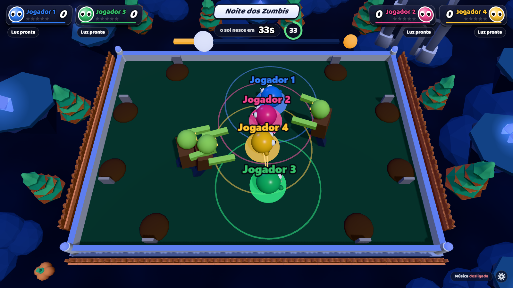 | 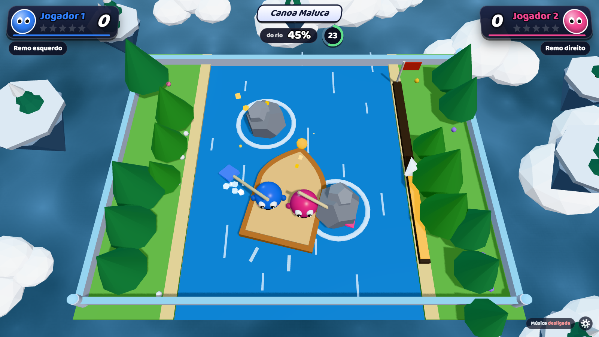 |
| **Noite dos Zumbis (Todos juntos):** aguentar até o sol nascer; o círculo mostra o alcance da luz de cada um | **Canoa Maluca (Todos juntos):** cada um rema de um lado e o bote só anda reto com os dois |
| 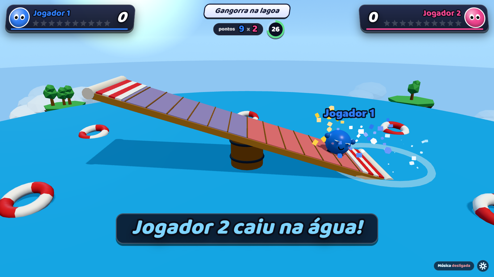 | 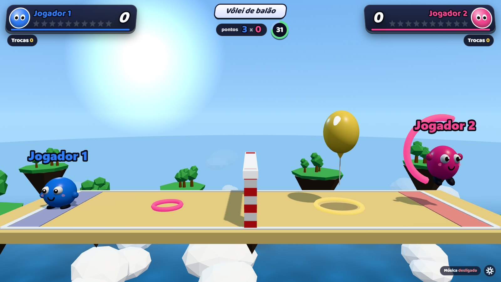 |
| **Gangorra na lagoa (Duelo):** o peso de cada um inclina a tábua | **Vôlei de balão (Duelo):** o anel no chão mostra onde o balão vai cair |
| 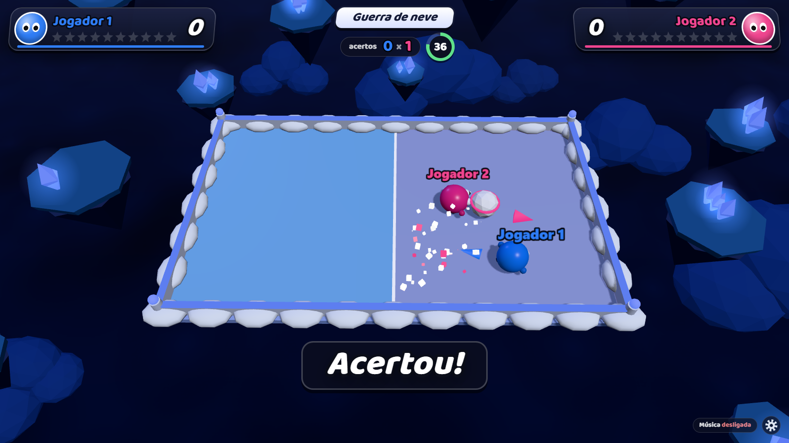 | 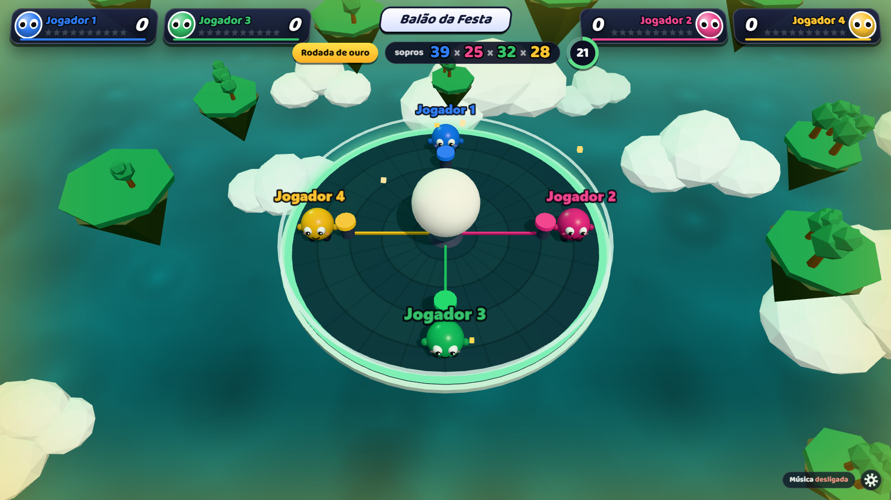 |
| **Guerra de neve (Duelo):** a bola cresce enquanto rola e vale mais quando é grande | **Balão da Festa (Cada um por si):** quem der o sopro que estoura perde |

**Versão anterior** (os jogos e as telas existem, mas alguns textos mudaram: o menu do celular dizia "Clássico" e "Festa" onde hoje diz Duelo, Cada um por si, Duplas e Todos juntos, e a Noite dos Zumbis foi refeita depois do print):

| | |
|---|---|
|  |  |
| **Futebol de dupla:** quatro jogadores em dois times, placar de gols e faixa de gol | **Tinta na tela:** dois times pintam o chão, o placar mostra a área de cada um |
| 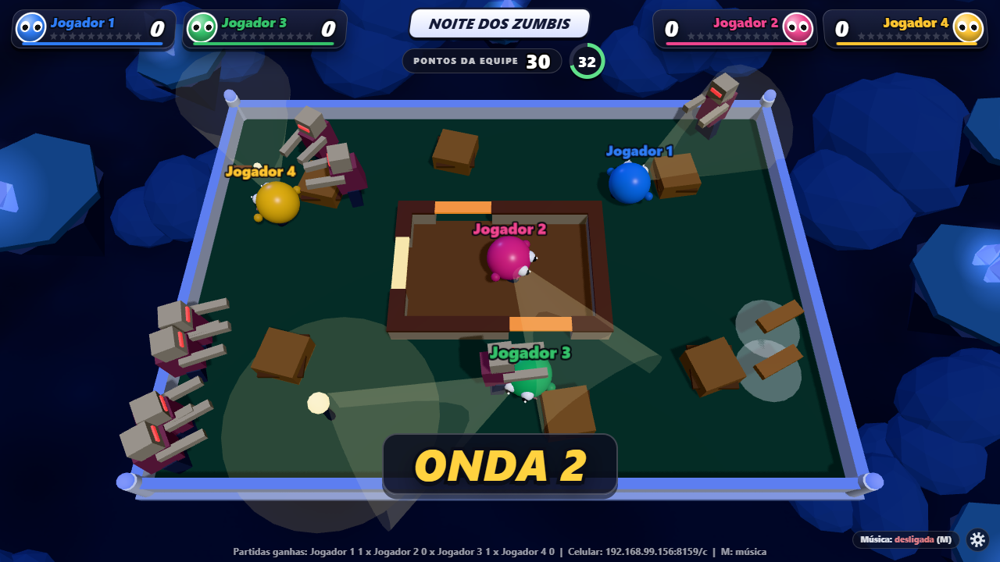 | 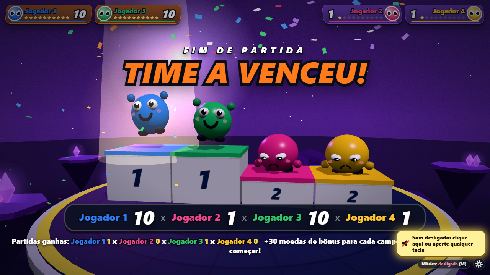 |
| **Noite dos zumbis:** cooperativo com quatro jogadores e uma onda anunciada na tela (versão anterior do minijogo) | **Fim de partida em duplas:** "Time A venceu!" com o pódio dos quatro |
|  |  |
| **Kart maluco:** tela dividida, uma câmera atrás de cada kart | **Faixas de destaque:** ponto e virada no sumô, com o selo "Vale dobro" |
|  | 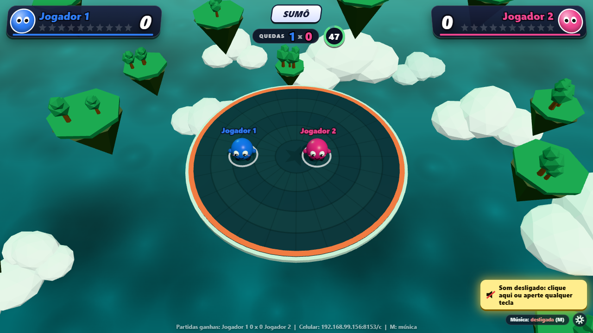 |
| **Labirinto de bombas:** caixas e pilares, com contadores de bombas e fogo de cada jogador | **Sumô:** arena redonda, placar de quedas e tempo no topo |
| 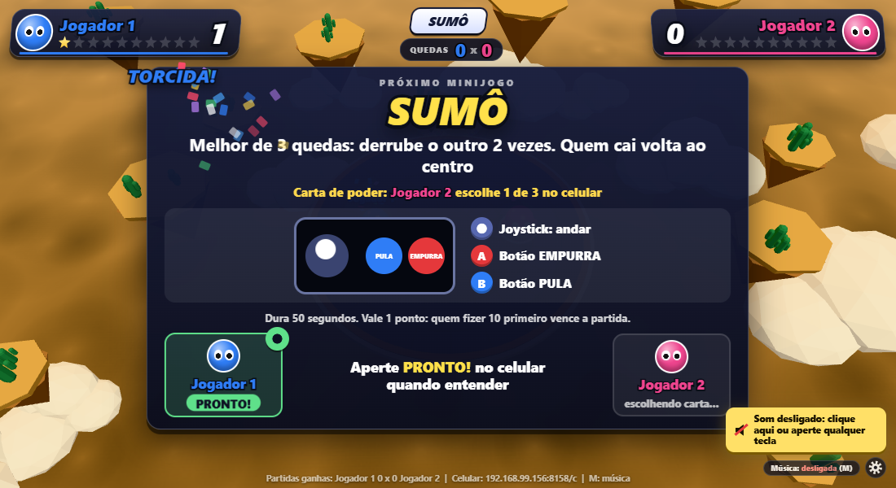 | |
| **Explicação da rodada:** regra, desenho do controle e botões de pronto, com a torcida em confete no canto | |

**No celular:**

| | | |
|---|---|---|
| 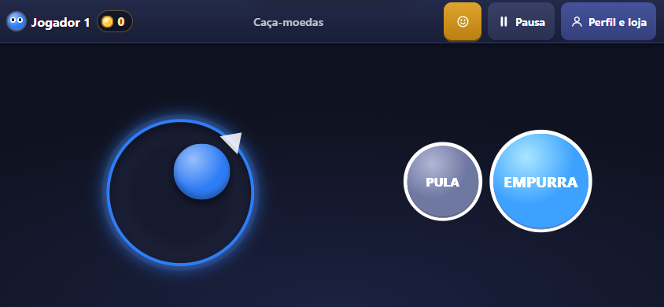 | 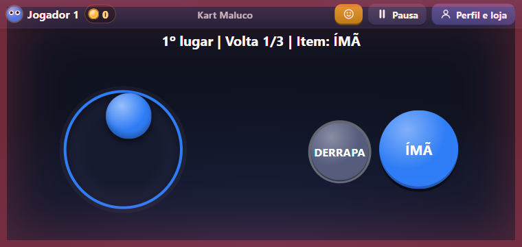 | 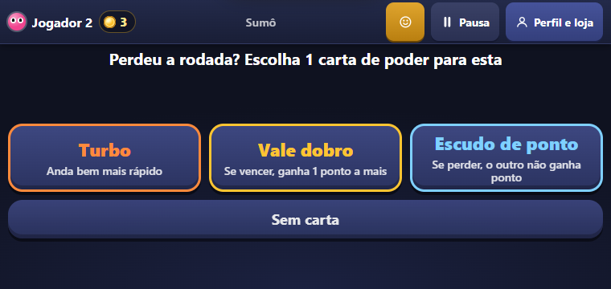 |
| Joystick à esquerda, botões PULA e EMPURRA à direita, no Caça-moedas | Controle do kart: joystick, DERRAPA e ÍMÃ, com a posição e a volta em texto | Cartas de poder para quem perdeu a rodada |

| |
|---|
| 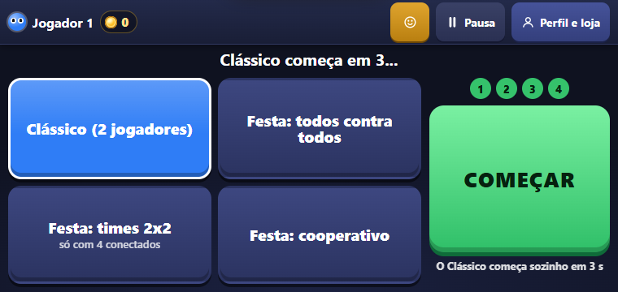 |
| Menu do Jogador 1 (versão anterior, com os nomes antigos das brincadeiras) |

A pasta `docs/prints` tem ainda `espera-4.png`, a sala de espera com quatro conectados, que não aparece aqui porque mostra o título e o endereço de rede da versão anterior.

## Créditos e licenças

- O código do jogo está sob a licença [MIT](LICENSE).
- [three.js](https://threejs.org) (MIT), usado para o 3D. A licença acompanha o pacote em `node_modules/three/LICENSE`.
- Modelos 3D do [Kenney](https://kenney.nl) (CC0, domínio público): `modelos/furniture-kit`, `modelos/graveyard-kit` e `modelos/survival-kit`. O `License.txt` de cada pacote está ao lado dos arquivos. Hoje o jogo usa o `furniture-kit` na sala de espera e o `graveyard-kit` na Noite dos zumbis.
- Fonte [Baloo 2](https://github.com/EkType/Baloo2) (SIL Open Font License 1.1), em `fontes/baloo2.woff2`, com a licença em [`fontes/OFL.txt`](fontes/OFL.txt).
- O pacote do Windows leva o Node.js dentro do zip, com a licença dele em `node/LICENSE`.

Mais sobre a escolha de manter a licença ao lado de cada arquivo de terceiros: [ADR 0005](docs/adr/0005-modelos-e-fonte-de-terceiros-com-licenca-ao-lado.md).
