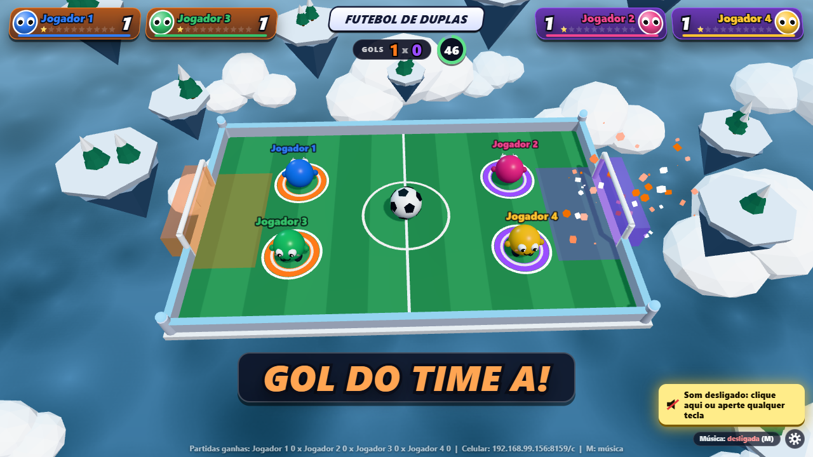
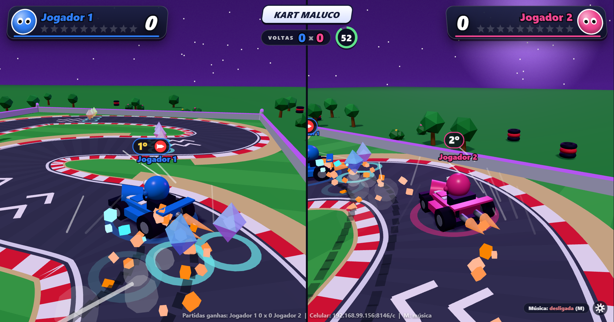
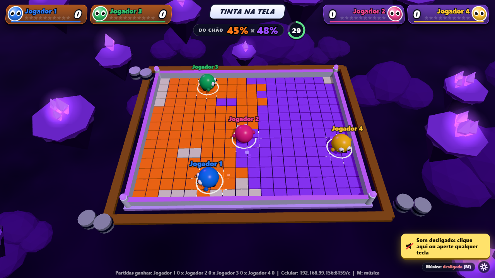
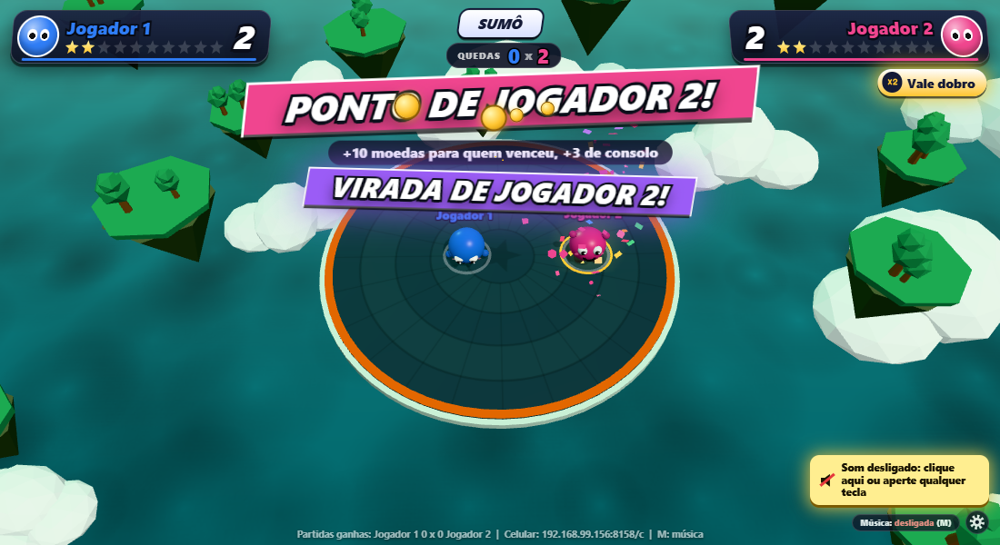
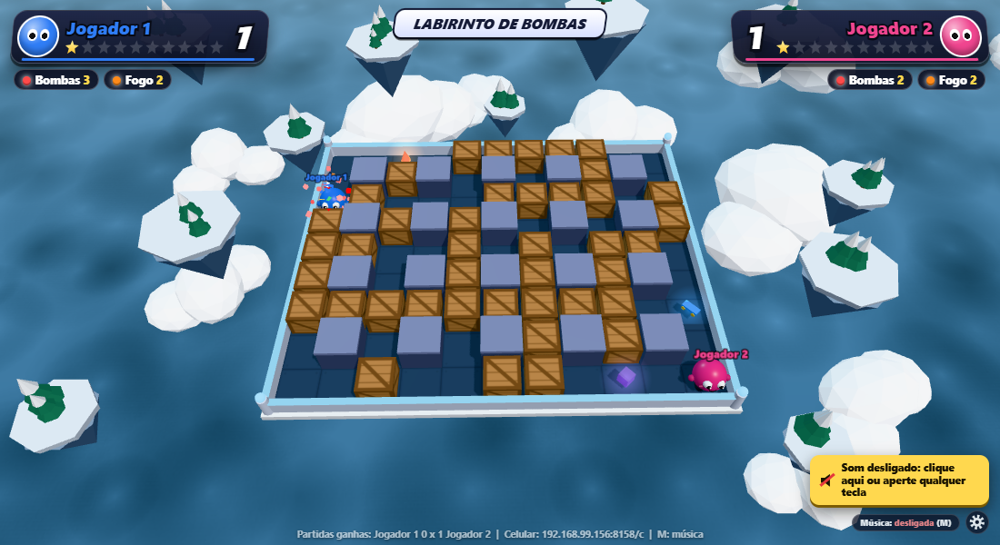
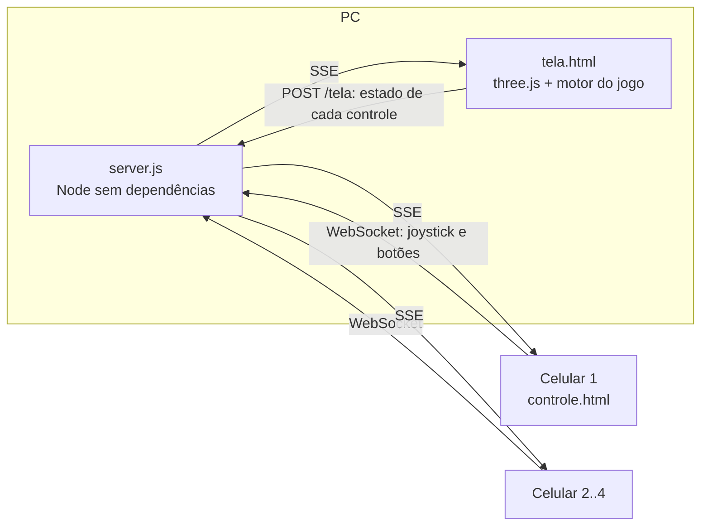

<div align="center">

# Minijogos de Sofá

**Party game 3D para jogar no PC com o celular como controle.**
Até 4 pessoas, 54 minijogos, nada para instalar no celular e nada de internet.




</div>

Nasceu para jogar em casa, no sofá, com a família. A TV (ou o monitor) mostra o jogo em 3D, e cada pessoa abre uma página no próprio celular, que vira joystick e botões. Tudo roda na rede Wi-Fi de casa, com um servidor Node pequeno e sem nenhuma dependência além do three.js.

## Como jogar

**Jeito fácil (Windows):**

1. Baixe o `minijogos-de-sofa-windows.zip` na página de [Releases](https://github.com/hugh514/minijogos-de-sofa/releases). Ele já traz o Node junto.
2. Extraia o zip **inteiro** numa pasta e dê dois cliques em `JOGAR.bat`.
   - Se o Windows avisar que o arquivo veio da internet, clique em "Mais informações" e depois em "Executar assim mesmo".
   - Se o firewall perguntar, permita em **rede privada**, para os celulares conseguirem conectar.
3. A tela do jogo abre no navegador. Nos celulares, conectados no mesmo Wi-Fi, leia o QR code da tela ou digite o endereço que aparece.

**Pelo código (qualquer sistema):**

```bash
git clone https://github.com/hugh514/minijogos-de-sofa.git
cd minijogos-de-sofa
npm install --omit=dev
npm start
```

Abra `http://localhost:8080` no PC e o endereço `http://<ip-do-pc>:8080/c` nos celulares.

## Modos

| Modo | Jogadores | Como funciona |
|---|---|---|
| **Clássico** | 2 | 50 minijogos em rotação. Quem fizer 10 pontos leva a partida. |
| **Todos contra todos** | 2 a 4 | Minijogos feitos para várias pessoas na arena. |
| **Times 2x2** | 4 | Azul e verde contra rosa e amarelo. O ponto é do time. |
| **Cooperativo** | 2 a 4 | Todos contra o jogo. A partida tem 5 noites contra zumbis. |

O celular do Jogador 1 vira o menu, onde se escolhe o modo antes de começar.

## Prints

| | |
|---|---|
|  |  |
| **Kart maluco:** tela dividida, câmera atrás de cada kart, drift e itens | **Tinta na tela:** pinte o chão, o time com mais área vence |
|  |  |
| **Noite dos zumbis:** cooperativo com lanternas e casa segura | **Faixas de destaque:** virada, sequência, ponto da partida |
|  |  |
| **Labirinto de bombas:** itens de bomba extra, fogo e patins | **Sumô:** melhor de 3 quedas, arena que encolhe |

**No celular:**

| | | |
|---|---|---|
|  |  |  |
| Joystick que nasce onde o dedo encosta | Menu de modos do anfitrião | Cartas de poder para quem perdeu a rodada |

## O que tem dentro

- **54 minijogos:** sumô, futebol, kart, labirinto de bombas, hóquei, queimada, pescaria, leilão cego, cor mentirosa, zumbis e muitos outros. Cada rodada dura de 20 a 50 segundos.
- **Controle no celular feito para jogar olhando a TV:**
  - joystick flutuante com zona morta e curva de resposta;
  - a metade inteira da tela vale como botão, e dá para deslizar o dedo entre A e B;
  - vibração quando o joystick chega na borda e no impacto (no iPhone, um flash na tela faz esse papel).
- **Cartas de poder:** quem perde a rodada escolhe Turbo, Vale dobro, Escudo, Dash rápido, Pulo alto ou Moedas em dobro.
- **Clima de festa:**
  - reações com emoji e som;
  - torcida com confete;
  - câmera lenta no ponto decisivo;
  - pódio no fim;
  - perfil, moedas, loja de cores e chapéus, salvos no próprio celular.
- **Latência baixa:** as entradas chegam por WebSocket (cerca de 1 ms na rede de casa) e o estado volta para os celulares por Server-Sent Events.

## Como funciona



- `server.js` é só um carteiro: serve uma lista fechada de arquivos, valida e repassa as entradas, e não guarda regra de jogo.
- `logica.mjs` é o motor: física simples, rodadas, pontos, cartas e modos. Roda na tela e também nos testes, sem navegador.
- Cada minijogo é um arquivo em `jogos/` com `inicia`, `atualiza` e o desenho. A tela confere a pasta a cada 8 s e põe arquivo novo na rotação sozinha, sem reiniciar nada.

## Criar um minijogo

O contrato completo está em [`jogos/LEIA.md`](jogos/LEIA.md), e o padrão visual e de jogo em [`jogos/ESTILO.md`](jogos/ESTILO.md). Em resumo:

```js
export default {
  id: 'meu-jogo', nome: 'Meu jogo', dica: 'A regra em uma frase',
  inicia(p) { /* posiciona jogadores, cria o estado em p.dados */ },
  atualiza(p, dt) { /* devolve 0 ou 1 (vencedor), -1 (empate) ou undefined (segue) */ },
};
```

Ponha o arquivo em `jogos/` com o servidor ligado, e ele aparece na próxima rodada.

## Testes

```bash
npm test          # cerca de 600 testes de lógica, sem navegador
npx playwright install chromium   # uma vez, para os testes de navegador
npm run e2e       # sobe o servidor numa porta de teste e joga partidas completas no Chromium
```

Os testes de navegador simulam os celulares com toques de verdade, jogam rodadas inteiras e tiram prints. Cada minijogo também é testado com "dedos aleatórios" em dezenas de sementes, para garantir que nenhuma rodada acaba em menos de 5 segundos por um toque sem querer.

## Créditos

- [three.js](https://threejs.org) (MIT) para o 3D.
- Código sob a licença [MIT](LICENSE). Feito por brincadeira, para jogar em casa.
