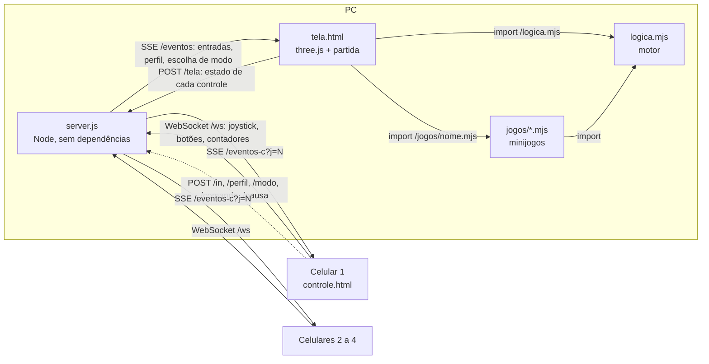

# Arquitetura

Este documento descreve só o que o código mostra. Quando algo é uma suposição ou uma limitação, está dito.

## Componentes

| Componente | Arquivo | O que faz | Onde roda |
|---|---|---|---|
| Servidor | `server.js` | Serve os arquivos de uma lista fechada e repassa mensagens entre os celulares e a tela. Não guarda regra de jogo. | Node, no PC |
| Tela | `tela.html` | Importa o motor, executa a partida, desenha em three.js, mostra o QR code e manda o estado de cada controle de volta ao servidor. | Navegador do PC |
| Controle | `controle.html` | Joystick, botões, menu do anfitrião, perfil e loja. Manda a entrada do jogador e mostra o que a tela mandar para aquele jogador. | Navegador de cada celular |
| Motor | `logica.mjs` | Física simples, rodadas, pontos, modos, rotação, cartas, modificadores e a trava de 5 s (`comMinimo`). Sem DOM. | Navegador (importado pela tela) e Node (testes) |
| Minijogos | `jogos/*.mjs` e os 10 embutidos em `logica.mjs` | Cada um tem `inicia` e `atualiza` (regra, sem navegador) e `monta` e `desenha` (three.js). | O mesmo do motor |

O motor é um módulo ES (`.mjs`) sem nenhuma referência a `window` ou `document`. A tela o importa pelo caminho `/logica.mjs` que o servidor serve, e os testes o importam direto no Node. É isso que permite testar regras de jogo sem navegador.

## Diagrama

As setas pontilhadas são o caminho de recuo: se o WebSocket não conecta, o celular manda a entrada por `POST /in`, um envio por vez. As ações do menu e da pausa (perfil, modo, comando, pausa) usam sempre `POST`.

## Fluxo de uma entrada, do celular até a TV

1. O jogador encosta o dedo no joystick de `controle.html`. O cálculo da zona morta e da curva do joystick, e a decisão de qual botão foi tocado, acontecem no próprio celular (funções `forcaJoystick` e `botaoNaPos`).
2. O celular manda uma mensagem pequena por WebSocket (`/ws`) com o lugar do jogador (`j`), o joystick (`x`, `y`), os botões (`d`, `b`) e contadores de toque (`n`, `nb`, `nop`), mais uma sessão e uma sequência. Quando passam 400 ms sem enviar nada, reenvia o estado atual como sinal de vida.
3. `server.js` valida o quadro, copia os campos um a um com coerção de tipo e escreve o resultado, como uma linha de texto, em todas as conexões de eventos da tela (`/eventos`).
4. `tela.html` recebe a mensagem e a entrega ao motor com `entrada(p, i, m)`. O motor limita o vetor do joystick a 1, descarta valor que não é número finito, e converte os contadores em "apertou" (`j.apertouA`, `j.apertouB`) para que um toque curto não se perca. Uma aba mais velha do mesmo jogador e uma mensagem com sequência atrasada são ignoradas.
5. A cada quadro, `passo(p, dt)` move os jogadores, chama `atualiza` do minijogo e, se há resultado, fecha a rodada e dá os pontos.
6. `desenha` atualiza os objetos 3D e a tela renderiza o quadro.
7. A tela monta o estado que cada celular deve mostrar (nome do minijogo, texto, tipo de controle, cartas, vibração) e o manda por `POST /tela`. Só envia se mudou e no máximo a cada 80 ms.
8. O servidor repassa cada estado ao celular do lugar certo pelo SSE `/eventos-c?j=N`, e o controle se redesenha.

## Por que o servidor não guarda regra de jogo

- **Uma só cópia da regra.** A regra vive em `logica.mjs` e nos minijogos, e é executada em um lugar, a tela. Se o servidor também tivesse regra, haveria duas cópias para manter iguais.
- **Teste sem rede.** Como o motor não depende do servidor, os testes de regra são chamadas de função no Node, sem abrir porta.
- **Superfície pequena.** Um servidor que só repassa mensagens tem pouco para atacar: valida, limita e encaminha. O que o servidor guarda é o mínimo para uma tela que abre depois se situar: o último perfil de cada jogador, o último estado de controle de cada jogador e a última escolha de modo.
- **Minijogo novo sem reiniciar.** A tela confere `/jogos` a cada 8 s e importa o arquivo novo ou alterado (`import('/jogos/<arquivo>?v=<data>')`). O servidor só lista e entrega o arquivo.

A consequência é que o servidor confia na tela para a regra. Isso é coerente com o cenário: a tela é o PC da casa, e quem controla a tela é quem controla o servidor.

## Decisões de segurança

O modelo de ameaça é uma rede de casa onde qualquer aparelho conectado pode falar com o servidor. Não há autenticação, e isso é uma decisão aceita e documentada (ver [`ADR 0001`](adr/0001-servidor-sem-dependencias-e-sem-regra.md) e `jogos/LEIA.md`). O que o código faz para limitar o estrago:

- **Lista fechada de arquivos.** Rotas fixas no objeto `ARQUIVOS`, verificadas com `Object.hasOwn` (uma chave como `constructor` não passa). Modelos só por `^/modelos/<pacote>/<arquivo>.(glb|png)$` e fontes só por `^/fontes/<nome>.woff2$`, ambos com letras minúsculas, números, `_` e `-`. Minijogos só por `^[a-z0-9-]+\.mjs$`, então `*.test.mjs` e `_teste.mjs` não saem. As licenças ficam ao lado dos modelos e da fonte e não são servidas. Nenhum caminho vem da URL sem passar por uma dessas expressões.
- **Validação do jogador.** O lugar é um inteiro de 1 a 4. Qualquer outra coisa é ignorada (`/in`, `/perfil`) ou recusada com 400 (`/eventos-c`).
- **Entrada hostil.** Cada campo da entrada é copiado com coerção de tipo, não repassado como veio. Os campos desconhecidos são descartados. O corpo de cada rota de escrita tem limite pequeno (de 100 bytes em `/comando` a 8000 bytes em `/tela`), e o que passa do limite derruba a conexão. O motor repete a defesa: valor que não é finito vira 0 e o vetor do joystick é normalizado.
- **Comandos de anfitrião.** `/modo` e `/comando` só aceitam quem se declara Jogador 1 e só valores de listas fechadas.
- **Memória limitada.** Um cliente de eventos que deixa mais de 64 KB parados é derrubado. Há no máximo 6 conexões de cada tipo.
- **WebSocket mínimo.** Aceita só quadros de texto mascarados de até 2000 bytes, e fecha a conexão por buffer grande ou 30 s sem sinal.
- **Dado do navegador é tratado como hostil.** O histórico de minijogos que a tela lê do `localStorage` é filtrado pelo motor (só ids curtos). O texto de minijogo passa por `textoSeguro` na tela e no celular.
- **Erro de minijogo não derruba a partida.** Exceção ou retorno inválido tira o minijogo da rotação, e a tela mostra um aviso com o nome dele, não a pilha de erro.

O que o projeto **não** faz: não autentica o anfitrião, não cifra o tráfego (HTTP e WebSocket sem TLS) e não foi feito para ser exposto à internet.

## Onde cada coisa é testada

Ver [`TESTES.md`](TESTES.md). Em resumo: o motor e os minijogos em `logica.test.mjs`, `logica-festa.test.mjs` e `jogos/*.test.mjs`; o servidor em `server.test.mjs`; trechos puros de `tela.html` e `controle.html` em `tela.test.mjs` e `controle.test.mjs`; o conjunto, com navegador de verdade, em `e2e/`.

## Decisões registradas

Os registros curtos de decisão estão em [`adr/`](adr/).
